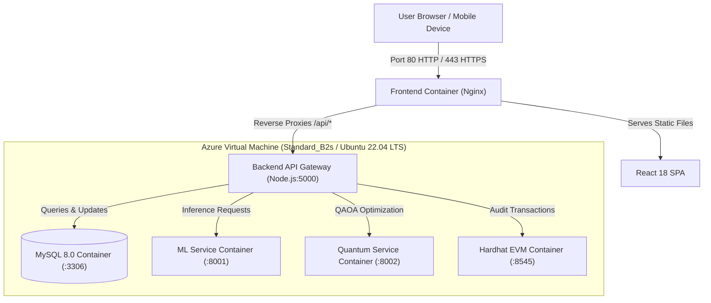

# Azure Cloud Deployment Guide: National Disaster Management System

This guide outlines the best, most reliable, and cost-effective method to deploy the **National Disaster Management and Resource Allocation Platform** onto Microsoft Azure.

---

## 1. Which Azure Deployment Way is Best?

Your application consists of **6 tightly-coupled microservices**:
1. **Frontend:** React + Vite (Web UI Dashboard)
2. **Backend Gateway:** Node.js Express API (Port 5000)
3. **Database Tier:** MySQL 8.0 (Port 3306)
4. **Machine Learning Tier:** Python FastAPI + Scikit-learn (Port 8001)
5. **Quantum Optimization Tier:** Python FastAPI + Qiskit QAOA (Port 8002)
6. **Blockchain Tier:** Hardhat EVM Node + Solidity Smart Contracts (Port 8545)

### Comparative Breakdown:

| Deployment Method | Complexity | Monthly Cost | Reliability for College Demo | Recommendation |
| :--- | :--- | :--- | :--- | :--- |
| **Option 1: Azure Ubuntu VM + Docker Compose** | **Low (1-Click)** | **$15 – $25/mo** (Free with $100 Student Credits) | **99.9% (Identical to local setup)** | ⭐⭐⭐⭐⭐ **STRONGLY RECOMMENDED** |
| **Option 2: Azure Container Apps (ACA)** | Medium-High | $45 – $70/mo (Requires Azure Database for MySQL Flexible Server) | 90% (Requires complex VNet & multi-container discovery) | Good for enterprise production |
| **Option 3: Azure App Service (PaaS)** | High | $60 – $100/mo (Requires 4 separate App Service plans) | 75% (Python Qiskit & Hardhat support is tricky) | Not recommended |

> **Verdict:** **Option 1 (Azure Virtual Machine + Docker Compose)** is by far the **fastest, cleanest, and most foolproof** method for your Semester 5 Cloud Computing course. It bundles all 6 services into Docker, guarantees zero network latency between services, avoids expensive cloud database fees, and gives you a single public IP (e.g., `http://20.120.45.67`) that you can show your professors and evaluators immediately.

---

## 2. Architecture on Azure VM



---

## 3. Step-by-Step Deployment (Option A: Using Azure Cloud Shell - Easiest)

You do **not** need to install Azure CLI or Docker on your laptop. You can do everything in your browser via **Azure Cloud Shell**:

### Step 1: Open Azure Cloud Shell
1. Go to [https://portal.azure.com](https://portal.azure.com) and log in with your college student account or personal Azure account.
2. Click the **Cloud Shell** icon (`>_`) in the top menu bar (or open [https://shell.azure.com](https://shell.azure.com)).
3. Select **Bash**.

### Step 2: Provision the Azure VM
Paste the following command into Cloud Shell:
```bash
# 1. Create Resource Group
az group create --name rg-disaster-management --location centralindia

# 2. Create Ubuntu 22.04 VM (Standard_B2s: 2 vCPUs, 4GB RAM)
az vm create \
  --resource-group rg-disaster-management \
  --name vm-disaster-mgmt \
  --image Ubuntu2204 \
  --size Standard_B2s \
  --admin-username azureuser \
  --generate-ssh-keys

# 3. Open Port 80 for Web Traffic
az vm open-port --resource-group rg-disaster-management --name vm-disaster-mgmt --port 80 --priority 1001
az vm open-port --resource-group rg-disaster-management --name vm-disaster-mgmt --port 443 --priority 1002
```

Azure will output the **Public IP Address** (e.g., `20.219.145.88`).

### Step 3: Connect to your VM and Deploy
Connect to your VM directly from Cloud Shell:
```bash
# Replace with your VM's public IP
ssh azureuser@<YOUR_VM_PUBLIC_IP>
```

Once inside the VM, clone your GitHub repository and run the automated deployment script:
```bash
# 1. Clone your repository
git clone <YOUR_GITHUB_REPO_URL> disaster-management
cd disaster-management

# 2. Run the 1-Click Deployment Script
bash deploy_azure_vm.sh
```

The script will:
- Automatically install Docker & Docker Compose.
- Initialize MySQL with all tables and pre-loaded disaster & warehouse data.
- Build and spin up all 6 microservices.
- Print your live URL!

---

## 4. Step-by-Step Deployment (Option B: Using Azure Portal GUI)

If you prefer using the graphical Azure Portal interface:

1. **Log in to [portal.azure.com](https://portal.azure.com)**.
2. Search for **Virtual Machines** and click **Create** > **Azure virtual machine**.
3. Fill in the **Basics** tab:
   - **Subscription:** Select your subscription (e.g., *Azure for Students*).
   - **Resource group:** Click *Create new* -> `rg-disaster-management`.
   - **Virtual machine name:** `vm-disaster-mgmt`.
   - **Region:** `Central India` (or nearest region).
   - **Image:** `Ubuntu Server 22.04 LTS - x64 Gen2`.
   - **Size:** `Standard_B2s` (2 vCPUs, 4 GiB memory) or `Standard_B4ms`.
   - **Authentication type:** *Password* or *SSH public key* (Password is easier: username `azureuser`, password `YourSecurePass123!`).
   - **Inbound port rules:** Allow `SSH (22)` and `HTTP (80)`.
4. Click **Review + Create**, then click **Create**.
5. Once deployment completes, click **Go to resource** and copy the **Public IP address**.
6. Open **PowerShell** or **Command Prompt** on your laptop and SSH into your VM:
   ```powershell
   ssh azureuser@<YOUR_VM_PUBLIC_IP>
   ```
7. Inside the VM, run:
   ```bash
   git clone <YOUR_REPO_URL> disaster-management
   cd disaster-management
   bash deploy_azure_vm.sh
   ```

---

## 5. Live Verification

Open your browser and navigate to:
```
http://<YOUR_VM_PUBLIC_IP>
```

- **Frontend Application:** `http://<YOUR_VM_PUBLIC_IP>/`
- **Backend API Status:** `http://<YOUR_VM_PUBLIC_IP>/api/health`
- **ML Disaster Prediction:** `http://<YOUR_VM_PUBLIC_IP>/predictions`
- **Quantum Resource Allocation:** `http://<YOUR_VM_PUBLIC_IP>/quantum-optimization`
- **Blockchain Ledger:** `http://<YOUR_VM_PUBLIC_IP>/blockchain-audit`

---

## 6. How to Stop / Save Credits After Your Presentation

When you are not presenting, you can stop the VM to prevent consuming Azure credits:
```bash
az vm deallocate --resource-group rg-disaster-management --name vm-disaster-mgmt
```
To restart it later before viva/evaluation:
```bash
az vm start --resource-group rg-disaster-management --name vm-disaster-mgmt
```
All Docker containers will automatically start back up on boot (`restart: always`).
