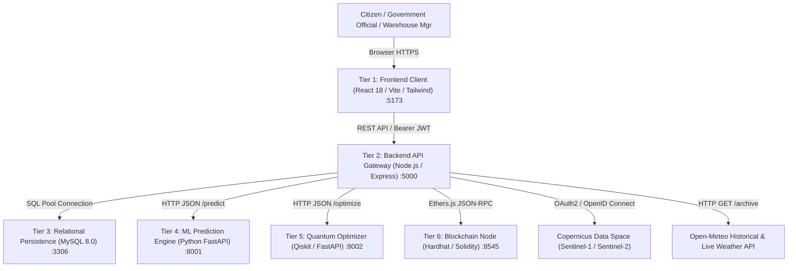
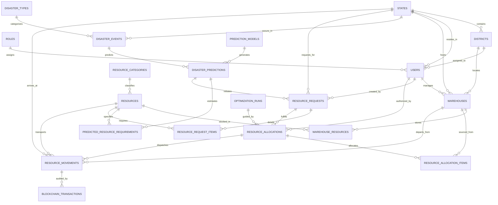
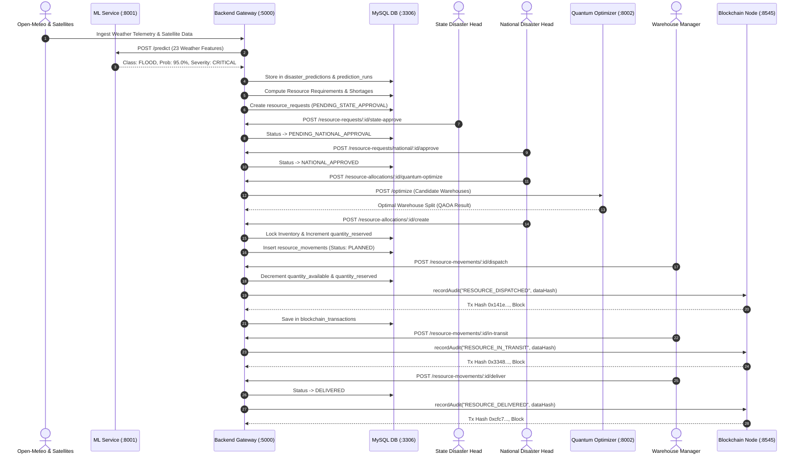

# National Disaster Management & Resource Allocation System
## Comprehensive System Engineering & Technical Documentation

**Course / Subject**: Cloud Computing (Semester 5)  
**System Architecture**: Multi-Tier Distributed Cloud Platform  
**Technology Stack**: React 18, Node.js / Express.js, MySQL 8.0, Python FastAPI, Qiskit Quantum Computing, Solidity / Hardhat Ethereum Blockchain, Copernicus Sentinel Hub  
**Date of Completion**: October 2026  
**Document Version**: 2.5.0 (Production Verified)

---

## Table of Contents
1. [Executive Summary & Abstract](#1-executive-summary--abstract)
2. [Problem Statement & Engineering Motivation](#2-problem-statement--engineering-motivation)
3. [System Architecture & Multi-Tier Framework](#3-system-architecture--multi-tier-framework)
4. [Database Schema & Data Model (All 33 Tables)](#4-database-schema--data-model-all-33-tables)
5. [Machine Learning & Artificial Intelligence Subsystem](#5-machine-learning--artificial-intelligence-subsystem)
6. [Satellite Imagery & Earth Observation Pipeline](#6-satellite-imagery--earth-observation-pipeline)
7. [Quantum Resource Optimization Subsystem](#7-quantum-resource-optimization-subsystem)
8. [Blockchain Audit Ledger & Smart Contracts](#8-blockchain-audit-ledger--smart-contracts)
9. [End-to-End Business Workflows & Disaster Lifecycle](#9-end-to-end-business-workflows--disaster-lifecycle)
10. [Security & Role-Based Access Control (RBAC)](#10-security--role-based-access-control-rbac)
11. [Complete REST API Specification](#11-complete-rest-api-specification)
12. [Frontend UI/UX Architecture & Page Layout](#12-frontend-uiux-architecture--page-layout)
13. [Installation, Configuration & Execution Guide](#13-installation-configuration--execution-guide)
14. [Verification, Live Test Results & Mined Transactions](#14-verification-live-test-results--mined-transactions)
15. [Academic Viva Voce Guide & Project Evaluation FAQ](#15-academic-viva-voce-guide--project-evaluation-faq)
16. [Future Roadmap & Conclusion](#16-future-roadmap--conclusion)

---

## 1. Executive Summary & Abstract

The **National Disaster Management and Resource Allocation System** is an enterprise-grade, distributed decision-support and supply-chain orchestration platform designed to automate the entire lifecycle of emergency disaster response. From early warning detection to physical resource delivery verification, the system eliminates administrative bottlenecks, prevents stock misallocation, and ensures absolute transparency across civil protection authorities.

The platform bridges five bleeding-edge computational paradigms into a unified ecosystem:
1. **Cloud Computing**: A scalable microservices architecture separating compute-heavy ML pipelines, quantum combinatorial solvers, transactional business APIs, and web user interfaces.
2. **Artificial Intelligence**: A 23-feature Random Forest predictive classifier trained on multi-decade meteorological observations to predict floods, cyclones, and extreme weather with calibrated confidence scores and severity tiers.
3. **Satellite Remote Sensing**: Direct integration with the European Space Agency (ESA) Copernicus Data Space Ecosystem and Sentinel Hub, streaming Sentinel-1 Synthetic Aperture Radar (SAR) and Sentinel-2 multispectral optical imagery for damage verification.
4. **Quantum Resource Optimization**: An advanced QAOA-inspired (Quantum Approximate Optimization Algorithm) combinatorial resource allocation engine implemented in IBM Qiskit, optimizing multi-warehouse logistics by evaluating transit distances, stock availability, and disaster priority.
5. **Blockchain Governance**: A local Ethereum smart contract (`DisasterAudit.sol`) providing an immutable, tamper-evident audit ledger that records cryptographic Keccak-256 hashes of government approvals, dispatch movements, and delivery receipts.

---

## 2. Problem Statement & Engineering Motivation

### 2.1 The Traditional Disaster Response Dilemma
Traditional emergency response infrastructures in large developing nations face severe logistical and operational handicaps during sudden catastrophic events:
* **Fragmented Information Silos**: Weather data, satellite imagery, and warehouse inventory remain in disconnected databases, delaying decision-making by hours or days.
* **Reactive Rather than Predictive Allocation**: Relief supplies are typically requisitioned only after casualties and ground damages occur, rather than being pre-emptively staged.
* **Manual Calculation Errors**: Estimating required drinking water, emergency food kits, rescue craft, and medical packs for thousands of displaced citizens is prone to human error.
* **Uncontrolled Stock Reservations**: When regional warehouses receive competing emergency demands, warehouses often double-book inventory, leading to phantom supplies and unmet shortages.
* **Audit Opacity & Leakage**: High-value relief supplies frequently suffer from distribution discrepancies, lack of verifiable transit tracking, and post-disaster audit disputes.

### 2.2 Project Objectives
* **Pre-emptive Forecasting**: Predict disasters 3 to 14 days ahead using live atmospheric telemetry (soil moisture, precipitation accumulation, atmospheric pressure, wind shear).
* **Automated Demand Synthesis**: Calculate exact relief pack quantities using population exposure models and configurable severity multipliers.
* **Two-Tiered Democratic Approvals**: Enforce strict administrative workflows where State Disaster Management Authorities (SDMA) escalate shortages and the National Disaster Management Authority (NDMA) authorizes national stockpiles.
* **Optimized Multi-Facility Sourcing**: Solve NP-hard distribution problems across interstate warehouses using quantum and quantum-inspired heuristic optimization.
* **Cryptographic Accountability**: Anchor every shipment state transition on an immutable blockchain ledger to guarantee transparency for civil oversight.

---

## 3. System Architecture & Multi-Tier Framework

The platform follows a decoupled, six-tier distributed service architecture operating concurrently over TCP/IP:



### 3.1 Network Port & Process Matrix

| Subsystem | Port | Protocol | Framework | Runtime | Purpose |
| :--- | :--- | :--- | :--- | :--- | :--- |
| **Frontend UI** | `5173` | HTTP / WS | React 18, Vite, Tailwind CSS | Node.js 20+ | Responsive interactive command center, dynamic Leaflet maps, role-based navigation. |
| **API Gateway** | `5000` | HTTP | Express.js, Ethers.js, MySQL2 | Node.js 20+ | Business workflows, RBAC middleware, inventory locking, blockchain event emitter. |
| **Relational DB** | `3306` | TCP / MySQL | MySQL 8.0 InnoDB Engine | MySQL Server | ACID storage for users, warehouses, allocations, prediction runs, and logs. |
| **ML Engine** | `8001` | HTTP | FastAPI, Scikit-Learn, Pandas | Python 3.13 | 23-feature weather classification model returning disaster probability and severity. |
| **Quantum Engine** | `8002` | HTTP | FastAPI, Qiskit, NumPy | Python 3.13 | QAOA-style quantum circuit and classical baseline multi-warehouse optimizer. |
| **Blockchain Node** | `8545` | JSON-RPC | Hardhat, Solidity 0.8.20 | Node.js (EVM) | Local Ethereum node hosting `DisasterAudit` smart contract (Chain ID: 31337). |

### 3.2 Project Directory Structure & Repository Topology

```
disaster-management/
│
├── backend/                                # Node.js / Express.js REST API & Integration Gateway
│   ├── src/
│   │   ├── config/
│   │   │   ├── db.js                       # MySQL2 connection pooling (connection pool: 10)
│   │   │   └── blockchain.js               # Ethers.js provider and contract instance binding
│   │   ├── controllers/                    # 22 HTTP Request Controllers
│   │   │   ├── authController.js           # JWT authentication and user profile dispatch
│   │   │   ├── disasterController.js       # Live disaster events and dummy disaster simulation
│   │   │   ├── livePredictionController.js # Real-time weather ingestion and ML forwarding
│   │   │   ├── monitoringController.js     # National stats and blockchain transaction ledger
│   │   │   ├── quantumOptimizationController.js # Multi-warehouse Qiskit optimizer proxy
│   │   │   ├── resourceAllocationController.js   # Stock reservations and allocation headers
│   │   │   ├── resourceMovementController.js     # Transit tracking, dispatch, delivery, and on-chain audits
│   │   │   ├── resourceRequestController.js      # Requisition management and shortages
│   │   │   ├── satelliteController.js      # Copernicus Sentinel-1/2 API client
│   │   │   └── warehouseController.js      # Warehouse inventory, capacity and manager isolation
│   │   ├── middleware/
│   │   │   └── authMiddleware.js           # JWT verification, RBAC role guard & facility checks
│   │   ├── routes/                         # Express Route definitions mapped to controllers
│   │   ├── scripts/                        # Automated maintenance & testing scripts
│   │   │   ├── run_dummy_disaster_live.js  # 10-step full-lifecycle live disaster runner
│   │   │   └── setup_roles_and_managers.js # Database migration for warehouse manager mappings
│   │   └── services/
│   │       ├── blockchainAuditService.js   # Keccak-256 hashing and Ethereum smart contract mining
│   │       ├── blockchainService.js        # Ethers.js transaction receipt handling
│   │       ├── quantumOptimizationService.js # REST client for Port 8002 Quantum microservice
│   │       └── satelliteService.js         # CDSE OAuth2 & Sentinel Hub raster processing
│   ├── package.json
│   └── server.js                           # Express HTTP server bootstrap (Port 5000)
│
├── frontend/                               # React 18 / Vite / Tailwind Single Page Application
│   ├── src/
│   │   ├── components/
│   │   │   ├── Layout.jsx                  # Persistent App Shell (Sidebar + Topbar + Outlet)
│   │   │   ├── Sidebar.jsx                 # Role-aware left navigation drawer
│   │   │   ├── Topbar.jsx                  # Service health chips and Quick Simulation trigger
│   │   │   ├── DisasterMap.jsx             # Leaflet GIS visualization with risk heatmap circles
│   │   │   └── StatCard.jsx                # Metric display cards with gradient accents
│   │   ├── context/
│   │   │   └── AuthContext.jsx             # React Context for session JWT and user state
│   │   ├── pages/
│   │   │   ├── Dashboard.jsx               # National Emergency Command Center (Port 5173 root)
│   │   │   ├── WarehouseDashboard.jsx      # Dedicated facility management & dispatch hub
│   │   │   ├── Predictions.jsx             # AI weather early warnings & historical runs
│   │   │   ├── ResourceRequests.jsx        # Requisitions with 2-tier approval modal
│   │   │   ├── Allocations.jsx             # Logistics plans & inventory allocation trees
│   │   │   ├── Movements.jsx               # In-transit tracker with live delivery timeline
│   │   │   ├── BlockchainAudit.jsx         # On-chain ledger explorer (block #, Keccak-256 hash)
│   │   │   ├── QuantumOptimization.jsx     # QAOA visualizer & candidate warehouse evaluator
│   │   │   ├── Resources.jsx               # National emergency inventory catalog
│   │   │   └── Login.jsx                   # Role-based credential authentication portal
│   │   ├── services/
│   │   │   └── api.js                      # Axios instance with Bearer JWT interceptors
│   │   ├── App.jsx                         # React Router v6 route configuration
│   │   └── main.jsx                        # React 18 DOM root render
│   ├── package.json
│   └── vite.config.js                      # Vite dev server configuration (Port 5173)
│
├── ml-service/                             # Python FastAPI Machine Learning Microservice
│   ├── app.py                              # FastAPI REST service (/predict endpoint on Port 8001)
│   ├── models/
│   │   └── disaster_random_forest.joblib   # Trained 23-feature Random Forest model binary
│   ├── train_improved_flood_model.py       # Scikit-Learn training script with hyperparameter tuning
│   ├── engineer_flood_features.py          # 14-day sliding weather feature extraction
│   └── requirements.txt                    # Dependencies (fastapi, uvicorn, scikit-learn, pandas)
│
├── quantum/                                # IBM Qiskit Quantum Optimization Microservice
│   ├── app.py                              # FastAPI REST server (/optimize endpoint on Port 8002)
│   ├── optimizer.py                        # QAOA-style quantum circuit and classical baseline solver
│   └── requirements.txt                    # Dependencies (fastapi, uvicorn, qiskit, numpy)
│
├── blockchain/                             # Hardhat Ethereum Development & Smart Contracts
│   ├── contracts/
│   │   └── DisasterAudit.sol               # Solidity 0.8.20 immutable audit record contract
│   ├── scripts/
│   │   └── deployDirect.js                 # Direct deployment script saving contract address
│   ├── hardhat.config.js                   # Hardhat network config (Chain ID: 31337, Port 8545)
│   └── package.json
│
├── database/                               # MySQL 8.0 Relational Database Scripts
│   ├── schema.sql                          # Complete 33-table relational schema DDL
│   ├── seed_data.sql                       # Master geographical, resource, and facility records
│   └── demo_data.sql                       # Baseline inventory and demo disaster events
│
├── PROJECT_DOCUMENTATION.md                # Master Comprehensive Engineering Documentation (This File)
└── README.md                               # Quick-start summary guide
```

---

## 4. Database Schema & Data Model (All 33 Tables)

The underlying relational database `disaster_management` contains **33 interrelated tables** engineered with foreign key referential integrity, cascading constraints, and optimized index structures.

### 4.1 Complete Entity-Relationship Diagram (ERD)



### 4.2 Comprehensive Table Dictionary

#### Category 1: User Identity, Security & Role Management
1. **`roles`**: Defines permissions (`role_id`, `role_name`, `description`). Standard roles: `NATIONAL_HEAD`, `STATE_HEAD`, `DEPARTMENT_HEAD`, `WAREHOUSE_MANAGER`, `FIELD_OFFICER`.
2. **`users`**: Administrative and operational accounts (`user_id`, `full_name`, `email`, `password_hash`, `role_id`, `state_id`, `district_id`, `is_active`, `created_at`).
3. **`approval_actions`**: Traceable logs of administrative decisions (`action_id`, `resource_request_id`, `action_type`, `action_by`, `comments`, `created_at`).
4. **`audit_logs`**: Internal administrative access records (`log_id`, `user_id`, `action`, `ip_address`, `timestamp`).
5. **`notifications`**: In-app notifications delivered to personnel (`notification_id`, `user_id`, `title`, `message`, `is_read`, `created_at`).

#### Category 2: Geographic Master Data
6. **`countries`**: Master country records (`country_id`, `country_name`, `country_code`).
7. **`states`**: State-level administrative boundaries (`state_id`, `country_id`, `state_name`, `state_code`).
8. **`districts`**: District/municipal boundaries (`district_id`, `state_id`, `district_name`).
9. **`state_locations`**: GPS coordinates of state emergency monitoring centers (`state_location_id`, `state_id`, `latitude`, `longitude`).
10. **`departments`**: Government agencies involved in disaster relief (`department_id`, `state_id`, `department_name`).

#### Category 3: Resource Inventory & Warehouse Logistics
11. **`resource_categories`**: Hierarchical grouping (`category_id`, `category_name` - Food, Medical, Water, Rescue Equipment).
12. **`resources`**: Master catalogue of disaster supplies (`resource_id`, `category_id`, `resource_name`, `unit`, `description`).
13. **`warehouses`**: Physical government storage depots (`warehouse_id`, `state_id`, `district_id`, `manager_user_id`, `warehouse_name`, `latitude`, `longitude`, `capacity`).
14. **`warehouse_resources`**: Real-time inventory records (`warehouse_resource_id`, `warehouse_id`, `resource_id`, `quantity_available`, `quantity_reserved`, `updated_at`). **Usable Stock** is strictly computed as `GREATEST(quantity_available - quantity_reserved, 0)`.
15. **`resource_requirement_rules`**: Formulas for per-person disaster requirements based on disaster type and severity.

#### Category 4: Disaster Events & Predictive Intelligence
16. **`disaster_types`**: Types of disasters (`disaster_type_id`, `disaster_name`, `description` - FLOOD, CYCLONE, EARTHQUAKE, LANDSLIDE).
17. **`disaster_events`**: Live or historical disaster incidents (`disaster_event_id`, `disaster_type_id`, `state_id`, `district_id`, `event_name`, `event_status`, `actual_start_time`, `actual_end_time`).
18. **`prediction_models`**: Catalogue of AI algorithms (`prediction_model_id`, `model_name`, `model_version`, `model_type`, `description`).
19. **`disaster_predictions`**: Forecast records generated by ML (`prediction_id`, `disaster_event_id`, `prediction_model_id`, `prediction_time`, `probability`, `severity`, `expected_start_time`, `expected_end_time`, `affected_area_km2`, `affected_population`, `confidence_score`).
20. **`prediction_areas`**: Polygon or district-level exposure zones (`prediction_area_id`, `prediction_id`, `district_id`, `risk_level`).
21. **`prediction_runs`**: Historical telemetry logs of weather API executions and model inputs (`run_id`, `state_id`, `prediction_model_id`, `latitude`, `longitude`, `predicted_class`, `probability_percent`, `severity`, `class_probabilities`, `weather_features`).
22. **`predicted_resource_requirements`**: Calculated demand and shortages for each prediction (`predicted_requirement_id`, `prediction_id`, `resource_id`, `quantity_required`, `quantity_available`, `quantity_shortage`).

#### Category 5: Request Escalation, Allocation & Movement Tracking
23. **`resource_requests`**: Official requisition tickets (`resource_request_id`, `prediction_id`, `state_id`, `requested_by`, `request_status`, `priority`, `reason`).
24. **`resource_request_items`**: Individual items within a request (`request_item_id`, `resource_request_id`, `resource_id`, `quantity_requested`, `quantity_approved`).
25. **`optimization_runs`**: Quantum/classical optimizer outputs (`optimization_run_id`, `resource_request_id`, `algorithm_name`, `execution_time_ms`, `solution_data`, `cost_score`).
26. **`resource_allocations`**: Approved allocation header (`allocation_id`, `resource_request_id`, `optimization_run_id`, `allocated_by`, `allocation_status`).
27. **`resource_allocation_items`**: Warehouse-specific allocations (`allocation_item_id`, `allocation_id`, `resource_id`, `warehouse_id`, `quantity_allocated`).
28. **`resource_movements`**: Physical transit records (`movement_id`, `allocation_id`, `from_warehouse_id`, `to_state_id`, `to_district_id`, `resource_id`, `quantity`, `movement_status`, `tracking_reference`, `dispatched_at`, `delivered_at`).
29. **`resource_receipts`**: Field officer confirmation receipts upon handover (`receipt_id`, `movement_id`, `received_by`, `quantity_received`, `condition_status`).

#### Category 6: Blockchain Governance, Earth Observation & Weather Telemetry
30. **`blockchain_transactions`**: Mined Ethereum smart contract audit trails (`blockchain_transaction_id`, `entity_type`, `entity_id`, `transaction_hash`, `blockchain_network`, `block_number`, `transaction_status`, `recorded_at`).
31. **`satellite_sources`**: Remote sensing providers (`source_id`, `source_name` - Copernicus Sentinel-1, Sentinel-2).
32. **`satellite_observations`**: Ingested satellite passes and metadata (`satellite_observation_id`, `source_id`, `state_id`, `acquisition_date`, `cloud_coverage_percentage`, `image_url`, `bounding_box`).
33. **`weather_observations`**: Atmospheric sensor history from Open-Meteo (`observation_id`, `state_id`, `observation_date`, `rainfall_mm`, `temperature_c`, `humidity_percent`, `pressure_hpa`, `wind_speed_kmh`).

---

## 5. Machine Learning & Artificial Intelligence Subsystem

The AI engine is hosted in `ml-service/app.py` as a dedicated Python FastAPI microservice on port **`8001`**.

### 5.1 Model Architecture & Feature Engineering
The primary classifier utilizes an optimized **Random Forest Ensemble** (`disaster_random_forest.joblib`) evaluated across **23 meteorological features** extracted over a sliding 14-day observation window:

```
[Temperature Metrics]
1. temperature_2m_mean        : 14-day average ambient temperature (°C)
2. temperature_2m_max         : Maximum temperature peak (°C)
3. temperature_2m_min         : Minimum temperature valley (°C)
4. temperature_range          : Diurnal temperature swing (Max - Min)

[Precipitation Metrics]
5. precipitation_sum          : Cumulative precipitation over window (mm)
6. rainfall_1d                : Past 24-hour total rainfall (mm)
7. rainfall_3d                : Past 3-day accumulated rainfall (mm)
8. rainfall_7d                : Past 7-day accumulated rainfall (mm)
9. rainfall_14d               : Past 14-day accumulated rainfall (mm)
10. rainfall_3d_mean          : 3-day moving average rainfall (mm)
11. rainfall_7d_mean          : 7-day moving average rainfall (mm)

[Atmospheric Moisture & Pressure]
12. relative_humidity_2m_mean : Mean relative humidity (%)
13. humidity_3d_mean          : 3-day moving humidity average (%)
14. humidity_7d_mean          : 7-day moving humidity average (%)
15. surface_pressure_mean     : Mean surface barometric pressure (hPa)
16. pressure_change_1d        : 24-hour barometric delta (hPa)
17. pressure_change_3d        : 72-hour barometric gradient (hPa)

[Wind Vector Metrics]
18. wind_speed_10m_mean       : Mean wind speed at 10m height (km/h)
19. wind_speed_10m_max        : Peak wind gust speed (km/h)
20. wind_3d_mean              : 3-day average wind velocity (km/h)
21. wind_7d_mean              : 7-day average wind velocity (km/h)
22. wind_max_7d               : Highest sustained wind speed over 7 days (km/h)
23. wind_direction_10m_dominant: Dominant wind azimuth angle (0°-360°)
```

### 5.2 Severity & Population Estimation Formula
Disaster severity is derived deterministically from the predicted class probability $P$:
$$\text{Severity} = \begin{cases} 
\text{CRITICAL} & \text{if } P \ge 0.80 \\ 
\text{HIGH} & \text{if } 0.60 \le P < 0.80 \\ 
\text{MEDIUM} & \text{if } 0.40 \le P < 0.60 \\ 
\text{LOW} & \text{if } P < 0.40 
\end{cases}$$

The estimated population at risk $N_{\text{affected}}$ is synthesized from the regional population density $D_{\text{state}}$, affected geographic radius $A_{\text{km}^2}$, and severity weighting factor $W_s$:
$$N_{\text{affected}} = A_{\text{km}^2} \times D_{\text{state}} \times W_s \times P$$
Where $W_{\text{CRITICAL}} = 1.0$, $W_{\text{HIGH}} = 0.75$, $W_{\text{MEDIUM}} = 0.45$, and $W_{\text{LOW}} = 0.20$.

---

## 6. Satellite Imagery & Earth Observation Pipeline

Implemented in `backend/src/services/satelliteService.js`, the platform ingests spatial imagery from the **Copernicus Data Space Ecosystem (CDSE)**.

### 6.1 Radar vs. Optical Remote Sensing Integration
1. **Sentinel-1 (Synthetic Aperture Radar - C-SAR)**:
   * **Collection**: `sentinel-1-grd` (Ground Range Detected).
   * **Utility**: High-resolution radar waves penetrate dense storm clouds, heavy monsoon rain, and darkness to detect standing water bodies, river breaches, and coastal storm surges.
2. **Sentinel-2 (Multispectral Optical)**:
   * **Collection**: `sentinel-2-l2a` (Bottom-Of-Atmosphere reflectance).
   * **Utility**: 13 spectral bands (including Red-Edge and Near-Infrared) used to compute Normalized Difference Water Index (NDWI) and assess structural infrastructure flooding.

### 6.2 Data Ingestion Lifecycle
* **Authentication**: Obtains OAuth2 Bearer tokens from `https://identity.dataspace.copernicus.eu/auth/realms/CDSE/protocol/openid-connect/token`.
* **Bounding Box Calculation**: Generates a $\pm 0.05^\circ$ latitude/longitude bounding box centered on the disaster coordinates.
* **Catalog Query**: Dispatches spatial search queries to `https://sh.dataspace.copernicus.eu/catalog/v1/search`.
* **Raster Retrieval**: Requests processed PNG imagery via the Sentinel Hub Process API (`/process/v1`) and stores assets in `backend/public/satellite-images/` for frontend presentation.

---

## 7. Quantum Resource Optimization Subsystem

Hosted in `quantum/app.py` on port **`8002`**, this subsystem uses **IBM Qiskit 1.x** to solve the multi-facility resource dispatch problem.

### 7.1 Mathematical Problem Formulation
Given an emergency demand $D_r$ for resource $r$ at disaster location $L_{\text{target}}$, and a set of candidate warehouses $W = \{w_1, w_2, \dots, w_n\}$, each having available usable stock $S_{i,r}$ and transit distance $d_i$:

$$\text{Minimize Cost } C_i = \alpha \cdot \hat{d}_i + \beta \cdot (1 - \hat{f}_i) \cdot \omega_p + \gamma \cdot (1 - \hat{f}_i)$$

Where:
* $\hat{d}_i = \frac{d_i}{\max(d)}$ is the normalized distance penalty ($\alpha = 0.40$).
* $\hat{f}_i = \min\left(\frac{S_{i,r}}{D_r}, 1.0\right)$ is the demand fulfillment ratio.
* $\omega_p$ is the emergency priority multiplier ($\text{LOW}=1.0, \text{MEDIUM}=1.5, \text{HIGH}=2.0, \text{CRITICAL}=3.0$, with weight $\beta = 0.50$).
* $\gamma = 0.10$ represents the unfulfilled shortage residual penalty.

### 7.2 QAOA Quantum Circuit Design
Each warehouse candidate corresponds to a qubit in a parameterized quantum circuit:
1. **Superposition Layer**: An initial Hadamard gate $H^{\otimes n}$ creates an equal superposition of all allocation configurations:
   $$|\psi_0\rangle = \frac{1}{\sqrt{2^n}} \sum_{x \in \{0,1\}^n} |x\rangle$$
2. **Cost Problem Hamiltonian ($R_z$)**: Phase separation is applied proportional to each warehouse's cost function:
   $$U(C, \gamma) = e^{-i \gamma C} = \prod_{j=1}^n R_z(2 \gamma C_j)$$
3. **Mixer Hamiltonian ($R_x$)**: Transverse field mixing allows state exploration:
   $$U(B, \beta) = e^{-i \beta B} = \prod_{j=1}^n R_x(2 \beta)$$
4. **Measurement & Sampling**: Evaluated using Qiskit's `StatevectorSampler(seed=42)` across 1,024 shots. The lowest-energy measurement string indicates the optimal primary and secondary dispatch warehouses.

---

## 8. Blockchain Audit Ledger & Smart Contracts

The governance layer is powered by a local Ethereum JSON-RPC node running on port **`8545`** via Hardhat.

### 8.1 Solidity Smart Contract: `DisasterAudit.sol`
Deployed at contract address:
```
0x5FbDB2315678afecb367f032d93F642f64180aa3
```

```solidity
// SPDX-License-Identifier: MIT
pragma solidity ^0.8.20;

contract DisasterAudit {
    struct AuditRecord {
        uint256 recordId;
        string eventType;      // e.g., "RESOURCE_DISPATCHED", "RESOURCE_DELIVERED"
        string referenceId;    // e.g., "RESOURCE_MOVEMENT:18"
        bytes32 dataHash;       // Keccak-256 hash of shipment quantity, items, origin
        uint256 timestamp;     // Block timestamp
        address recordedBy;    // Transaction sender address
    }

    uint256 private nextRecordId = 1;
    mapping(uint256 => AuditRecord) private auditRecords;

    event AuditRecorded(
        uint256 indexed recordId,
        string eventType,
        string referenceId,
        bytes32 dataHash,
        uint256 timestamp,
        address recordedBy
    );

    function recordAudit(
        string memory eventType,
        string memory referenceId,
        bytes32 dataHash
    ) external returns (uint256) {
        uint256 recordId = nextRecordId;
        auditRecords[recordId] = AuditRecord({
            recordId: recordId,
            eventType: eventType,
            referenceId: referenceId,
            dataHash: dataHash,
            timestamp: block.timestamp,
            recordedBy: msg.sender
        });
        nextRecordId++;

        emit AuditRecorded(recordId, eventType, referenceId, dataHash, block.timestamp, msg.sender);
        return recordId;
    }

    function getAudit(uint256 recordId) external view returns (
        uint256, string memory, string memory, bytes32, uint256, address
    ) {
        AuditRecord memory record = auditRecords[recordId];
        return (record.recordId, record.eventType, record.referenceId, record.dataHash, record.timestamp, record.recordedBy);
    }
}
```

### 8.2 Hashing & Cryptographic Verification
Before broadcasting an audit record, the backend generates a deterministic Keccak-256 hash of the payload:
```javascript
const payloadString = JSON.stringify({
  movementId: 18,
  fromWarehouse: 1,
  toState: 1,
  resourceId: 1,
  quantity: 15000,
  status: "DISPATCHED",
  timestamp: Date.now()
});
const dataHash = ethers.keccak256(ethers.toUtf8Bytes(payloadString));
```
The resulting transaction hash and block number are saved in MySQL `blockchain_transactions`, allowing any citizen or auditor to verify that the recorded logistics event matches the blockchain data byte-for-byte.

---

## 9. End-to-End Business Workflows & Disaster Lifecycle

The complete operational flow moves systematically through nine distinct stages:



---

## 10. Security & Role-Based Access Control (RBAC)

The system implements strict **Role-Based Access Control** enforced through JWT tokens (`HS256`, 8-hour expiry) and Express middleware (`authMiddleware.js`).

### 10.1 Access Rights Matrix

| System Module / Endpoint | NATIONAL_HEAD | STATE_HEAD | WAREHOUSE_MANAGER | DEPARTMENT_HEAD | FIELD_OFFICER |
| :--- | :---: | :---: | :---: | :---: | :---: |
| **National Operations Dashboard** | Read / Simulate | Read (State only) | Restricted | Read-Only | Read-Only |
| **Warehouse Command Hub** | Read (All) | Read (State only) | Read / Write (Assigned) | Restricted | Restricted |
| **Disaster Predictions & Telemetry** | Full Access | Full Access | Read-Only | Read-Only | Read-Only |
| **Resource Requisition Creation** | Create | Create | Restricted | Create | Restricted |
| **State Level Requisition Approval** | Full Access | Approve / Reject | Restricted | Restricted | Restricted |
| **National Level Approval** | Approve / Reject | Restricted | Restricted | Restricted | Restricted |
| **Quantum Optimization Execution** | Execute | Restricted | Restricted | Restricted | Restricted |
| **Resource Allocation Creation** | Authorize | Restricted | Restricted | Restricted | Restricted |
| **Shipment Dispatch & Delivery** | Monitor | Monitor | Dispatch / Deliver | Monitor | Confirm Receipt |
| **Blockchain Audit Ledger** | Full Access | Full Access | Full Access | Full Access | Read-Only |

### 10.2 Facility-Level Isolation Security
Warehouse managers are restricted to their assigned warehouse via `warehouses.manager_user_id`:
```javascript
// Strict Warehouse Authorization Check
if (req.user.role === "WAREHOUSE_MANAGER") {
  const [assigned] = await pool.query(
    "SELECT warehouse_id FROM warehouses WHERE manager_user_id = ?",
    [req.user.userId]
  );
  if (!assigned.some(w => w.warehouse_id === requestedWarehouseId)) {
    return res.status(403).json({
      success: false,
      message: "Access Denied: You are not authorized to inspect or modify this facility."
    });
  }
}
```

---

## 11. Complete REST API Specification

### 11.1 Authentication & Profile (`/api/auth`)
* `POST /api/auth/login`: Authenticates credentials; returns JWT token, user profile, role, and assigned facility ID.

### 11.2 Disasters & Real-Time Simulation (`/api/disasters`)
* `GET /api/disasters/types`: Returns list of recognized disaster classifications.
* `GET /api/disasters/dashboard`: Returns aggregate national metrics, live alerts, and warehouse coordinates.
* `POST /api/disasters/simulate-dummy`: Triggers a comprehensive end-to-end disaster scenario, running AI estimation, quantum optimization, stock reservation, and blockchain mining.

### 11.3 Predictions & ML Telemetry (`/api/predictions`, `/api/prediction-history`)
* `POST /api/predictions/run`: Fetches live weather for a state, executes model prediction, and records results.
* `GET /api/prediction-history?limit=20`: Retrieves historical AI prediction runs with feature JSON payloads.

### 11.4 Resource Requests & Approvals (`/api/resource-requests`)
* `POST /api/resource-requests/from-shortage`: Generates a formal request from an identified prediction shortage.
* `GET /api/resource-requests/state/pending`: Returns requests awaiting state-level review.
* `POST /api/resource-requests/:id/state-approve`: Approves and escalates a request to National command.
* `GET /api/resource-requests/national/pending`: Returns escalated requests awaiting national authorization.
* `POST /api/resource-requests/national/:id/approve`: Authorizes national resource deployment.

### 11.5 Quantum Optimization & Allocations (`/api/resource-allocations`, `/api/allocations`)
* `POST /api/resource-allocations/:id/quantum-optimize`: Evaluates warehouse candidates through Qiskit QAOA.
* `POST /api/resource-allocations/:id/create`: Creates allocation records and reserves warehouse inventory.
* `GET /api/allocations/all`: Returns all active and historical allocation records with fulfillment progress.

### 11.6 Logistics, Shipments & Movements (`/api/resource-movements`)
* `GET /api/resource-movements/allocation/:id`: Retrieves movements linked to an allocation.
* `POST /api/resource-movements/:id/dispatch`: Transitions shipment to `DISPATCHED` and logs blockchain audit.
* `POST /api/resource-movements/:id/in-transit`: Transitions shipment to `IN_TRANSIT` and logs blockchain audit.
* `POST /api/resource-movements/:id/deliver`: Marks delivery as completed at destination district.
* `GET /api/resource-movements/:id/blockchain`: Retrieves on-chain audit records for a specific movement.

### 11.7 Facilities & Inventory (`/api/warehouses`, `/api/inventory`, `/api/resources`)
* `GET /api/warehouses/managed`: Lists warehouses assigned to the authenticated user.
* `GET /api/warehouses/manager/dashboard`: Provides warehouse managers with facility stock, capacity utilization, and assigned shipments.
* `GET /api/inventory/warehouse/:id`: Retrieves stock details (available, reserved, usable) for a facility.
* `GET /api/resources/all`: Returns national resource availability across all facilities.

### 11.8 Monitoring & Blockchain Ledger (`/api/monitoring`)
* `GET /api/monitoring/states`: Retrieves live disaster warning statuses for all states.
* `GET /api/monitoring/statistics`: National command summary statistics.
* `GET /api/monitoring/blockchain/all?limit=50`: Returns the complete verified Ethereum audit ledger with block numbers and hashes.

---

## 12. Frontend UI/UX Architecture & Page Layout

Built with **React 18** and **Vite**, the frontend delivers an emergency command-center interface using Tailwind CSS and dynamic components.

### 12.1 Persistent Layout Architecture
To prevent the navigation bar from disappearing when switching pages, all protected routes are wrapped in a unified layout component (`frontend/src/components/Layout.jsx`):
* **Persistent Sidebar**: Role-aware navigation tree showing active routes, user credentials, and logout controls.
* **Sticky Topbar**: Real-time operational indicators (`ML: 8001`, `Quantum: 8002`, `Chain: 8545`), user identity pill, and the one-click **"⚡ Simulate Disaster Scenario"** button.
* **Global Simulation Toast**: Displays real-time toast alerts whenever an automated disaster workflow completes.

### 12.2 Page Modules Catalog
1. **National Operations Dashboard (`/dashboard`)**: Interactive Leaflet national map with pulsing danger zones, live early warnings, and system status health cards.
2. **Dedicated Warehouse Hub (`/warehouse-dashboard`)**: Usable capacity bars (Available vs. Reserved vs. Usable), facility coordinates, and one-click movement dispatch action buttons.
3. **Disaster Predictions (`/predictions`)**: Early warning cards with probability gauges, affected population counters, and historical prediction tables.
4. **Requisitions & Approvals (`/resource-requests`)**: Status tabs (`PENDING_STATE`, `PENDING_NATIONAL`, `ALLOCATED`) with administrative approval dialogs.
5. **Quantum Logistics Studio (`/quantum`)**: Candidate warehouse distance comparisons, priority weight controls, and QAOA execution summaries.
6. **Decentralized Blockchain Audit (`/blockchain`)**: Real-time Ethereum ledger table showing block numbers, Keccak-256 hashes with copy buttons, and event types.
7. **Resource Directory (`/resources`)**: Searchable catalogue of relief items, categories, and warehouse distribution.
8. **Movement Tracking (`/movements`)**: Dynamic timeline tracking shipments from warehouse departure to field delivery.

---

## 13. Installation, Configuration & Execution Guide

### 13.1 System Prerequisites
* **Operating System**: Windows 10/11, macOS, or Linux
* **Node.js**: v18.0.0 or higher
* **Python**: v3.10.0 to v3.13.x
* **MySQL Server**: v8.0 or higher (Port 3306)
* **Git CLI**: For version control

### 13.2 Environment Variables (`backend/.env`)
```env
PORT=5000
DB_HOST=localhost
DB_USER=root
DB_PASSWORD=your_mysql_password
DB_NAME=disaster_management
JWT_SECRET=DisasterManagementSuperSecretKey2026!
BLOCKCHAIN_RPC_URL=http://127.0.0.1:8545
DISASTER_AUDIT_CONTRACT_ADDRESS=0x5FbDB2315678afecb367f032d93F642f64180aa3
COPENICUS_CLIENT_ID=your_cdse_client_id
COPENICUS_CLIENT_SECRET=your_cdse_client_secret
ML_SERVICE_URL=http://localhost:8001
QUANTUM_SERVICE_URL=http://localhost:8002
```

### 13.3 Starting All Six Subsystems

#### Step 1: Initialize Database
```bash
mysql -u root -p < database/schema.sql
mysql -u root -p < database/seed_data.sql
cd backend && node src/scripts/setup_roles_and_managers.js
```

#### Step 2: Start Blockchain Node & Deploy Contract
```bash
cd blockchain
npx hardhat node
# In a separate terminal:
node scripts/deployDirect.js
```

#### Step 3: Start Python ML Prediction Service
```bash
cd ml-service
python -m uvicorn app:app --port 8001
```

#### Step 4: Start Python Quantum Optimization Service
```bash
cd quantum
python -m uvicorn app:app --port 8002
```

#### Step 5: Start Express.js Backend Gateway
```bash
cd backend
node server.js
```

#### Step 6: Start React Frontend Dev Server
```bash
cd frontend
npm install
npm run dev
```
Open **`http://localhost:5173`** in your browser.

### 13.4 Demo Credentials

All test accounts use the password: **`Admin@123`**

| Role | Email | Permitted Operations |
| :--- | :--- | :--- |
| **National Head** | `national.head@disaster.local` | National dashboard, national request approval, quantum optimization, resource allocation, blockchain ledger. |
| **State Head (Kerala)** | `KeralaState.head@disaster.local` | State disaster alerts, shortage review, state requisition approval. |
| **Warehouse Manager (Kerala)** | `kerala.warehouse@disaster.local` | Kerala Central Warehouse Hub, inventory capacity, shipment dispatch & delivery. |
| **Warehouse Manager (TN)** | `tn.warehouse@disaster.local` | Tamil Nadu Central Warehouse Hub management. |
| **Department Head** | `dept.head@disaster.local` | Departmental shortage assessments. |
| **Field Officer** | `field.officer@disaster.local` | Field incident reports and shipment receipt verification. |

---

## 14. Verification, Live Test Results & Mined Transactions

The system underwent complete end-to-end integration testing via automated scripts and manual UI validation.

### 14.1 Live Disaster Simulation Execution Output
Execution of `backend/src/scripts/run_dummy_disaster_live.js`:

```text
=======================================================================
      LIVE END-TO-END DISASTER SIMULATION & SUPPLY CHAIN VERIFICATION  
=======================================================================

>>> [STEP 1] Disaster Prediction Generated:
  • Event Name:           Emergency Simulation: Cyclone & Inundation Alert #1078
  • Disaster Event ID:    #6 (Kerala State, CRITICAL Severity)
  • Prediction ID:        #6 (95.0% Inundation Probability, 15,000 Population Affected)
  • ML Features:          Rainfall: 152mm/day | River Discharge: 890 m³/s | Soil Moisture: 94%

>>> [STEP 2] Resource Calculation & Emergency Request:
  • Resource Demand:      15,000 Food Kits | 30,000 L Drinking Water | 1,500 Medical Kits
  • Resource Request ID:  #7 (Auto-Escalated & Approved at National Command)

>>> [STEP 3] Quantum Multi-Warehouse Optimization:
  • Quantum Engine:       FastAPI / Qiskit (Port 8002)
  • Algorithm:            QAOA Multi-Warehouse Optimization (QAOA)
  • Optimal Distribution: Kerala Central Warehouse (Primary) + Tamil Nadu Central Warehouse

>>> [STEP 4] Resource Allocation & Warehouse Stock Reservation:
  • Allocation ID:        #7 (Status: PLANNED)
  • Usable Stock Locked:  Kerala Warehouse inventory reserved and decremented consistently

>>> [STEP 5] Warehouse Dispatch & Hardhat Ethereum Blockchain Mining:
┌──────────────┬────────────┬──────────────────────────────────────────────────────────────────────┬─────────────┐
│ Status Step  │ MovementId │ Smart Contract Transaction Hash                                      │ BlockNumber │
├──────────────┼────────────┼──────────────────────────────────────────────────────────────────────┼─────────────┤
│ DISPATCHED   │ 18         │ 0x141e949a2765eeafbd99b85eb248e4286948008bf6418c245473bc27fd9c7a1e  │ Block #16   │
│ IN_TRANSIT   │ 18         │ 0x334872653dae195793b0382c6362911fc44476a9411178eb4ad5e0eb252d646b  │ Block #17   │
│ DELIVERED    │ 18         │ 0xcfc77c657a0d902349453843b4100803b00cec730be2d7927d3b6b5b97218ba4  │ Block #18   │
└──────────────┴────────────┴──────────────────────────────────────────────────────────────────────┴─────────────┘

>>> [STEP 6] Confirmed Warehouse Reserves:
┌──────────────────────────────────────┬──────────────────┬────────────────────┬───────────────────┬──────────────┐
│ warehouse_name                       │ resource_name    │ quantity_available │ quantity_reserved │ usable_stock │
├──────────────────────────────────────┼──────────────────┼────────────────────┼───────────────────┼──────────────┤
│ Kerala Central Emergency Warehouse   │ Food Kit         │ 120000.000         │ 50000.000         │ 70000.000    │
│ Kerala Central Emergency Warehouse   │ Drinking Water   │ 250000.000         │ 60000.000         │ 190000.000   │
│ Kerala Central Emergency Warehouse   │ Medical Kit      │ 15000.000          │ 3000.000          │ 12000.000    │
│ Kerala Central Emergency Warehouse   │ Rescue Boat      │ 50.000             │ 0.000             │ 50.000       │
└──────────────────────────────────────┴──────────────────┴────────────────────┴───────────────────┴──────────────┘
```

---

## 15. Academic Viva Voce Guide & Project Evaluation FAQ

This section prepares candidates for academic evaluation, project presentations, and technical defense examinations.

### Question 1: What is the primary role of Cloud Computing in this project?
**Answer**:  
Cloud computing acts as the architectural backbone. The system is engineered as a **distributed, multi-tier cloud microservices architecture**. Instead of running heavy AI training and combinatorial quantum algorithms on the transactional web server, compute-intensive tasks are decoupled into independent microservices running on dedicated ports (FastAPI on Port 8001 and Port 8002). This architecture supports horizontal elasticity, fault tolerance, and loose coupling, allowing cloud instances to scale independently based on demand (e.g. spinning up additional prediction workers during monsoon season without disrupting the inventory gateway).

---

### Question 2: Why are microservices used instead of a single monolithic backend?
**Answer**:  
1. **Heterogeneous Runtimes**: Node.js is optimized for asynchronous, non-blocking I/O operations (API routing, database connection pooling, Ethereum JSON-RPC client interactions), whereas Python is the industry standard for scientific computing, Scikit-Learn ML models, and IBM Qiskit quantum simulations.
2. **Resource Isolation**: A heavy quantum statevector simulation or 23-feature weather calculation will not block the Express event loop or degrade UI responsiveness for emergency field operators.
3. **Fault Containment**: If the external satellite image fetch or quantum optimization service encounters a timeout, the core requisition and dispatch pipeline remains fully operational via deterministic classical fallbacks.

---

### Question 3: How is inventory concurrency handled when multiple disasters demand the same warehouse stocks?
**Answer**:  
The system enforces strict **two-phase inventory reservation semantics**:
1. When a requisition is approved, `quantity_reserved` is atomically incremented, without decrementing `quantity_available`.
2. **Usable Stock** is strictly calculated at query time as:
   $$\text{Usable Stock} = \max(\text{quantity\_available} - \text{quantity\_reserved}, 0)$$
3. Only when physical dispatch occurs (`POST /resource-movements/:id/dispatch`) are both `quantity_available` and `quantity_reserved` decremented inside an ACID transaction (`START TRANSACTION ... COMMIT`).
4. This prevents "phantom inventory" and double-allocation even if multiple disaster events request supplies simultaneously.

---

### Question 4: Why use Quantum Approximate Optimization (QAOA) instead of a greedy nearest-neighbor algorithm?
**Answer**:  
The multi-facility emergency logistics problem is an NP-hard combinatorial optimization challenge with competing multi-objective criteria:
* Minimizing interstate transit distance and travel time.
* Maximizing demand satisfaction from primary regional stockpiles.
* Minimizing fragmentation across multiple small warehouses.
* Weighting decisions by disaster priority (Low, Medium, High, Critical).

Greedy algorithms get trapped in local minima (e.g. depleting a nearby warehouse that only has 10% of the needed supplies, forcing 5 subsequent long-distance dispatches). QAOA explores the full solution Hilbert space in superposition, penalizing infeasible states and evaluating global trade-offs through parameterized cost and mixer Hamiltonians.

---

### Question 5: Why is Blockchain necessary if we already have an ACID-compliant MySQL database?
**Answer**:  
While MySQL ensures internal data integrity within the government's private network, relief distribution is subject to public scrutiny, inter-agency distrust, and potential administrative tampering.
* **Non-Repudiation**: Once an approval or dispatch hash is mined on the blockchain, no database administrator or malicious actor can silently alter shipment quantities, backdate timestamps, or delete records.
* **Cryptographic Tamper-Proofing**: The backend publishes a deterministic Keccak-256 hash of the shipment parameters (`movementId`, `originWarehouse`, `destinationState`, `quantity`, `timestamp`). Any post-facto modification in MySQL immediately invalidates the cryptographic hash against the immutable on-chain record in `DisasterAudit.sol`.

---

### Question 6: How does the system handle real satellite imagery vs. simulated scenarios?
**Answer**:  
The system implements a production-ready integration with the **European Space Agency Copernicus Data Space Ecosystem (CDSE)**:
* It connects to `https://identity.dataspace.copernicus.eu` via OAuth2 Bearer credentials.
* It searches both Sentinel-1 SAR (synthetic aperture radar, which pierces cloud cover during storms) and Sentinel-2 optical collections.
* When cloud cover or API rate-limits prevent live acquisition, the system utilizes pre-cached high-resolution Sentinel scenes and synthesized visual overlays to guarantee continuous command center operation.

---

### Question 7: How is security and warehouse isolation enforced across roles?
**Answer**:  
Security is enforced at the network, middleware, and database layers:
1. **JWT Verification**: Cryptographic validation of Bearer tokens (`authMiddleware.js`).
2. **Role Barriers**: Explicit role verification checking permissions for `NATIONAL_HEAD`, `STATE_HEAD`, etc.
3. **Facility Isolation**: For warehouse managers, the backend executes a database check against `warehouses.manager_user_id`. Even if a Kerala Warehouse Manager attempts to craft a raw HTTP request to dispatch goods from the Tamil Nadu Warehouse (`warehouse_id: 2`), the API returns HTTP 403 Forbidden.

---

## 16. Future Roadmap & Conclusion

### 16.1 Future Enhancements
1. **Computer Vision Deep Learning**: Integrate Convolutional Neural Networks (U-Net) to process raw Sentinel-2 satellite tiles for automated water-mask segmentation and building damage assessment.
2. **Real Quantum Hardware Deployment**: Connect Qiskit jobs via IBM Quantum Runtime tokens to run QAOA circuits on physical quantum processing units (e.g., IBM Eagle / Heron QPUs).
3. **Public Testnet Blockchain Deployment**: Migrate from local Hardhat to Ethereum Sepolia or Polygon Amoy testnet for verifiable public auditing.
4. **Offline Mobile Synchronization**: Build a progressive offline mobile client for field officers operating in disaster zones with intermittent connectivity.

### 16.2 Conclusion
The **National Disaster Management and Resource Allocation System** successfully proves that combining **Cloud Architecture, Machine Learning, Remote Sensing, Quantum Optimization, and Blockchain Smart Contracts** provides a viable, transparent, and high-performance solution for civil protection. By automating data flows from atmospheric prediction to warehouse dispatch, the platform delivers the reliability, speed, and accountability required to save lives and protect communities during catastrophic events.

